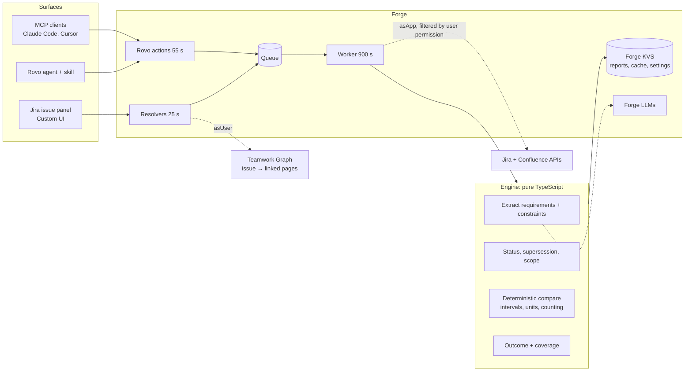

# Tether

**Keeps tickets tethered to reality.** Tether checks whether a Jira ticket's technical
requirements contradict the engineering decisions your team already recorded in
Confluence, and shows the evidence: the exact ticket sentence, the exact decision
sentence, whether that decision is still current, and whether it applies to this service
and environment.

Built on Atlassian Forge for Codegeist 2026 (Apps for Software Teams).

```
PAY-101  "The payment service must retry failed transactions exactly 5 times"
         "Each retry is logged with the gateway error code."
ADR-PAY-001 (accepted, current, supersedes ADR-PAY-000)
         "The payment service must retry failed transactions no more than 3 times."
→ CONFLICT · 1 of 2 requirements checked · Create clarification issue
```

What makes it different from an AI ticket reviewer:

- **Deterministic where it matters.** "Up to 5" vs "max 3" is not a conflict; "4 attempts including the first" equals "3 retries"; 15000 ms vs 10 s is. Interval maths, units and supersession are code, not prompts.
- **Honest uncertainty.** Four outcomes (Conflict, Needs review, No conflict found, Insufficient evidence), explicit coverage, and API failures are never shown as a pass.
- **Verified evidence.** Every quote is checked verbatim against its source.
- **Drift detection.** When a decision page changes, every ticket checked against it is flagged.
- **Everywhere your team works.** Jira issue panel, Rovo agent and skill, and MCP tools for Claude/Cursor, all backed by the same engine. Uses Teamwork Graph to find decisions linked to an issue. No external services: LLM calls run on Forge LLMs.

## Try it

Install link, step-by-step judge instructions and expected outcomes:
[docs/SUBMISSION.md → Judge instructions](docs/SUBMISSION.md#judge-instructions-final-paste-into-devpost-testing-instructions).
In short: install for Jira and Confluence, open Jira settings → Apps → Tether settings,
click **Load demo data**, then open **PAY-1** and run the check.

## Architecture



One check: the resolver reads the issue as the user and asks Teamwork Graph for linked
pages, then queues a job. The worker reads the ticket and decision pages (dropping pages
the user cannot read), extracts requirements and decision constraints with Forge LLMs
(constraints cached per page version), compares them deterministically, and stores the
report. The panel polls until it is ready. When a report is read, Tether compares the
decision page versions it used with the current ones and shows a drift banner if any
changed. Rovo and MCP call the same actions. No external services: no
`permissions.external`.

Engine rules, outcome logic, storage keys and security notes:
[docs/ARCHITECTURE.md](docs/ARCHITECTURE.md). Evaluation: [docs/EVAL.md](docs/EVAL.md).

## Repo map

```
manifest.yml              Forge modules: issue panel, admin page, queue, triggers, Rovo agent/skill/actions, rovo:mcp, llm
src/contracts/            Data contracts (zod). The team's single source of truth.
src/engine/               Analysis engine. Pure TypeScript, no @forge imports, fully unit-tested.
src/adapters/             Jira, Confluence, Teamwork Graph, Forge LLM, KVS
src/handlers/             Resolvers, queue worker, triggers, Rovo actions
static/report/            Custom UI (React + Vite). `npm run ui:dev` runs it with a mock backend.
skills/                   rovo:skill (also usable as an open SKILL.md for MCP clients)
prompts/                  Rovo agent prompt
eval/                     Golden decisions + scenarios (tests, fixtures, seed data, eval)
scripts/                  seed, fixtures, offline eval, manifest check
docs/                     PLAN, TEAM-SETUP, ARCHITECTURE, EVAL, SUBMISSION
```

## Quick start

```bash
npm install            # root + static/report
npm run check          # typecheck, 143 tests, offline eval 30/30, manifest schema, UI build
npm run ui:dev         # UI with mock backend at http://localhost:5174 (scenario picker at the top)
```

Forge setup, environments and what to share with teammates: [docs/TEAM-SETUP.md](docs/TEAM-SETUP.md).
Plan, workstreams and timeline: [docs/PLAN.md](docs/PLAN.md).

## Commands

| Command | What |
|---|---|
| `npm run check` | Everything CI runs |
| `npm test` / `npm run test:watch` | Unit tests |
| `npm run eval:offline` | Deterministic engine vs golden scenarios |
| `npm run fixtures` | Regenerate UI mock reports from the golden scenarios |
| `npm run seed -- --dry-run` | Seed decision pages + demo tickets into your site (needs `.env`) |
| `npm run manifest:check` | Validate `manifest.yml` against the Forge schema |
| `npm run ui:tunnel` + `forge tunnel -e dev-<you>` | UI hot reload inside Jira |
| `npm run deploy:dev` | Build UI and `forge deploy` |
