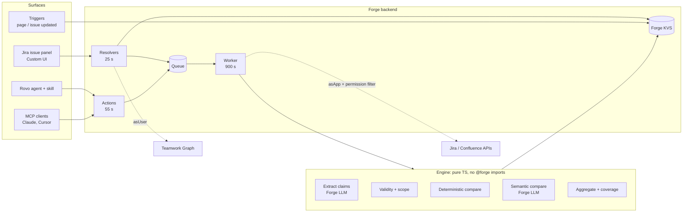

# Architecture

## Flow of one check

1. **Resolver `startAnalysis`** (user context, 25 s): reads the issue as the user (permission check), asks Teamwork Graph which Confluence pages are linked to it (TWG is user-context only), stores a `Job`, pushes it to the queue.
2. **Worker** (900 s): fetches the ticket and decision pages as the app, drops pages the requesting user cannot read, extracts decision constraints (cached per page version), extracts ticket claims with the decision vocabulary, assesses each claim, writes the `AnalysisReport`, indexes which decision pages were used (for drift detection).
3. **UI** polls `getJob` every 1.5 s and renders the report.
4. **Triggers**: a decision page update marks every issue checked against it as stale; an issue text update marks its report stale.

## Engine decision rules (per claim)

1. Retrieval failed → Insufficient evidence (`RETRIEVAL_FAILED`), never "no conflict".
2. No decision constrains the attribute → semantic fallback, else Insufficient evidence.
3. Decisions exist but scope (service/environment) does not match → Insufficient evidence (`DECISION_NOT_APPLICABLE`).
4. Supersession cycle → Needs review.
5. Only proposed/unknown decisions → Needs review if they disagree, else Insufficient evidence.
6. Two current decisions contradict each other → Needs review (`COMPETING_DECISIONS`).
7. Contradiction with a current decision → Conflict, unless conditions differ (Needs review), the decision is a "should" (Needs review), or the ticket quote is unverified (Needs review).
8. Counting ambiguous (attempts vs retries) and the interpretations disagree → Needs review.
9. Otherwise No conflict found (`CONSISTENT` or `CONSISTENT_IF_TIGHTER`).

Ticket outcome: any Conflict → Conflict; else any Needs review → Needs review; else any
unchecked material claim → Insufficient evidence; else No conflict found. A failed run has
no outcome.

## Ownership boundaries

| Folder | Owner | May import |
|---|---|---|
| `src/contracts/` | all three (PR label `contract`) | zod only |
| `src/engine/` | engine | contracts (enforced by `test/architecture.test.ts`) |
| `src/adapters/`, `src/handlers/`, `manifest.yml` | integration | engine, contracts, @forge/* |
| `static/report/` | UI | contracts (types only), engine/present (mock only) |
| `eval/` | engine | contracts |

## Storage (Forge KVS)

`job:<id>`, `report:<issueKey>`, `stale:<issueKey>`, `dindex:<pageId>:<issueKey>`,
`dcache:<pageId>:<version>`, `config`, `eval:latest`. Values ≤ 240 KiB.

## Security notes (also needed for Marketplace review)

- No egress: no `permissions.external`. LLM calls stay on Atlassian (Forge LLMs), keeping Runs on Atlassian eligibility.
- Issue key comes from module context, not from the UI payload, whenever available.
- Action inputs come from an LLM: never used for authorization; account id read from context.
- Follow-up issues are created **as the user**, after explicit confirmation.
- Eval web trigger requires a per-environment secret and only touches fixture data.
